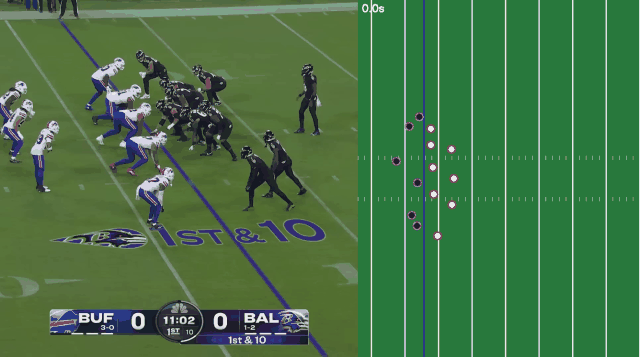

# 🏈 NFL 3D Replay

**NFL 중계 영상에서 선수를 추적하고, 움직이는 카메라를 보정해 실제 경기장 좌표(야드)로 바꾼 뒤 Unity에서 위에서 본 시점과 선수 시점으로 다시 재생하는 프로젝트**

> **English summary** — From a high-angle broadcast clip of a 49ers touchdown pass at the Rams (SF @ LAR), players are detected and tracked (YOLOv8m + ByteTrack). Frame-to-frame homographies are estimated from field-surface features only (grass, end zone paint, lines) and chained to the first frame, which is calibrated automatically to field coordinates (yards) from 5 detected yard lines × 2 hash-mark rows. The whole play from snap to the touchdown catch (6.5 s) is mapped onto the field: held-out hash marks land within 0.10 yd of their true position on average, and projected yard lines still sit on the painted lines in the last frame. The tracks are smoothed and replayed in Unity (top view + player POV).

| 위에서 본 재생 (스냅 ~ 터치다운, 경기장 좌표) | 추적 결과 |
|---|---|
|  |  |

빨강 = 샌프란시스코(SF), 흰색 = LA 램스(LAR), 파란 영역 = 엔드존

## 왜 만들었나

쿼터백이 수비 사이에서 패스할 곳을 찾고, 러닝백이 수비를 뚫고 달리는 순간을 그 선수의 시점으로 경험해 보고 싶었습니다. 경기 영상만으로 선수 위치를 경기장 좌표로 뽑아내면, NFL의 Next Gen Stats처럼 센서 없이도 위에서 내려다본 재생이나 특정 선수 시점의 재생을 만들 수 있다고 생각했습니다.

## 동작 방식

```
영상 ─▶ ① 선수 탐지·추적 ─▶ ② 카메라 움직임 추정 ─▶ ③ 첫 화면 → 경기장 좌표
                                                          │
Unity 재생 ◀─ ⑤ 궤적 평활화 ◀─ ④ 경기장 좌표 변환·필터·팀 분류 ◀┘
```

| 단계 | 스크립트 | 내용 |
|---|---|---|
| ① | `01_track_players.py` | YOLOv8m(COCO 사전학습)으로 사람 탐지, ByteTrack으로 프레임 간 ID 유지 |
| ② | `02_camera_motion.py` | 경기장 바닥(잔디·엔드존·흰 선)의 특징점만 광류로 추적해 프레임 간 호모그래피 추정, 누적해서 모든 프레임을 첫 화면 기준으로 정렬 |
| ③ | `03_field_calibration.py` | 첫 화면에서 야드 라인 5개와 해시마크 2줄을 자동으로 찾아, 교점 10개로 경기장(야드) 좌표 변환 계산 |
| ④ | `04_to_field.py` | 선수 발 위치를 경기장 좌표로 변환, 경기장 밖(벤치·관계자) 제거, 유니폼 색으로 팀 분류 |
| ⑤ | `05_smooth_tracks.py` | 짧은 공백 보간, Savitzky-Golay 필터로 떨림 제거, 한 ID 안에서 팀이 바뀌면 다른 ID로 분리 |
| ⑥ | `06_make_gifs.py` | 결과 이미지 생성 |

**왜 카메라 보정이 필요한가**: 중계 카메라는 플레이를 따라 이동하고 줌합니다. 화면 좌표를 그대로 쓰면 선수가 가만히 있어도 카메라가 움직이면 위치가 바뀝니다. 경기장 바닥은 평면이므로 연속한 두 프레임의 바닥은 호모그래피 하나로 이어지고, 이를 이어 붙이면 모든 프레임을 같은 기준으로 맞출 수 있습니다. 관중석·골대·사람처럼 바닥 평면 위에 있지 않은 물체는 시점에 따라 다르게 움직여 보정을 망치므로 특징점에서 뺐습니다.


*검증: 스냅부터 터치다운까지의 프레임을 첫 화면 기준으로 이어 붙인 파노라마. 야드 라인과 엔드존이 프레임을 넘어 끊김 없이 이어집니다.*

## 검증과 결과

- **경기장 좌표 정확도**: 기준점으로 쓰지 않은 1야드 간격 해시마크 44개를 변환한 결과, 정수 야드 위치와의 차이가 **평균 0.10야드**(최대 0.43야드)였습니다.
- **카메라 보정 누적 오차**: 0, 50, 100, 130, 160, 180, 195번 프레임에서 경기장 좌표의 0·5·10·15·20야드 라인을 화면으로 되돌려 그렸을 때, 마지막 프레임(카메라가 약 40% 줌아웃한 뒤)까지 모두 실제 흰 선 위에 놓였습니다.
- **필터**: 경기장 밖 사람과 스태프를 제거해 ID 44개 → 28개, 프레임당 평균 17.2명.
- **팀 분류**: 처음엔 밝은 빨강만 SF로 봐서, 선수가 몸을 돌려 유니폼이 그늘지면 SF가 LAR로 바뀌었습니다(SF 탐지의 7.8%). 진한 빨강까지 포함하도록 기준을 고치자 오분류가 SF 0.7%, LAR 0.5%로 줄었습니다(ID가 확실한 선수 17명 기준).
- **쿼터백 추적**: 쿼터백(13번)은 스냅부터 끝까지 같은 ID로 유지되는 것을 영상 크롭으로 확인했습니다. GIF에 QB, 터치다운 리시버는 TD로 표시했습니다.
- **평활화**: 프레임 간 떨림(평균 가속도) 0.048 → 0.007 야드/프레임², 원래 위치와의 차이는 평균 0.06야드.

## 한계

- **뭉친 선수는 일부 놓칩니다.** 스냅 순간 붙어 있는 공격 라인맨들은 사전학습 모델이 서로 가려진 선수를 놓쳐, 22명 중 평균 17명 정도만 잡힙니다.
- **ID가 바뀌는 경우가 있습니다.** 블로킹하며 겹친 선수에게 ID가 넘어가는 경우가 있습니다(이 영상에서는 1번). 팀이 바뀌는 지점에서 ID를 나눠 같은 점이 다른 팀 선수로 바뀌지 않게 했지만, 같은 팀 선수끼리 ID가 바뀌는 경우는 아직 구분하지 못합니다.
- **공은 추적하지 않습니다.** COCO의 'sports ball'로는 작은 미식축구공을 안정적으로 찾지 못했고, 공중에 뜬 공은 바닥 평면 기준 좌표 변환이 맞지 않습니다.
- **6.5초 이후(득점 세리머니)는 제외했습니다.** 카메라가 빠르게 줌인하는 구간입니다.

## 다음 단계

- **공 추적**: 미식축구공 데이터로 탐지 모델을 파인튜닝하고, 던진 위치와 받은 위치 사이를 포물선으로 이어 공의 높이까지 추정
- **실제 추적 데이터와 비교**: NFL Big Data Bowl의 Next Gen Stats 추적 데이터로 영상에서 뽑은 좌표의 오차를 직접 측정
- **미식축구 데이터로 추가 학습**: 뭉친 선수 분리와 ID 유지 개선

## 실행 방법

### Python
```bash
cd python
pip install -r requirements.txt
# 원본 영상을 python/data/nfl_sample.mp4 로 저장 (아래 '데이터 출처')
python scripts/01_track_players.py        # ~5분 (CPU)
python scripts/02_camera_motion.py --panorama
python scripts/03_field_calibration.py
python scripts/04_to_field.py
python scripts/05_smooth_tracks.py
python scripts/06_make_gifs.py
```
결과: `python/data/field_tracks.csv` (frame, id, team, X, Y). X는 골라인에서의 거리(엔드존이 음수), Y는 먼 쪽 사이드라인에서의 거리(야드)입니다.

### Unity (6000.0, URP)
1. `Assets/Scenes/MainScene.unity`를 엽니다.
2. ▶ 재생. `FieldReplay`가 `python/data/field_tracks.csv`를 읽어 경기장과 선수를 그립니다.

| 키 | 동작 |
|---|---|
| Space | 재생 / 정지 |
| ← / → | 한 프레임씩 이동 |
| ↑ / ↓ | 재생 속도 (기본 0.5배속) |
| R | 처음으로 |
| C | 위에서 보기 ↔ 선수 시점 |
| Tab | 시점 선수 변경 (기본: 터치다운을 받은 49ers 리시버) |

## 프로젝트 구조

```
├── Assets/
│   ├── Scenes/MainScene.unity
│   └── Scripts/
│       ├── FieldReplay.cs         # 재생, 경기장 그리기, 카메라 전환
│       ├── FieldTracksLoader.cs   # CSV 로더
│       └── CameraRig.cs           # 선수 시점 카메라 (달리는 방향을 바라봄)
├── python/
│   ├── scripts/                   # 01 ~ 06 파이프라인
│   ├── experiments/               # 초기 시도 (DeepSORT + 화면 안정화)
│   └── data/                      # 추적 결과, 호모그래피, 경기장 좌표
└── media/                          # README 이미지
```

## 개발 과정

1. 프레임마다 YOLOv8n으로 탐지하고 화면 픽셀 좌표를 그대로 Unity에 옮김 → 카메라가 움직이면 위치가 틀어짐
2. DeepSORT 추적 + 화면 안정화 + 경기장 영역(ROI) 필터 시도 (`python/experiments/`)
3. ByteTrack 추적 + 카메라 움직임 누적 보정 + 경기장 규격 기반 좌표 변환으로 재구성. 옆에서 찍은 중계 영상(데릭 헨리 터치다운 런)에서는 사이드라인에 서 있는 사람들의 좌표가 점점 밀리는 것으로 보정 오차 누적을 확인했고, 처음 6.7초만 변환할 수 있었음
4. 카메라가 높은 곳에서 덜 움직이는 영상으로 바꾸고, 카메라 보정에 경기장 바닥 특징점만 쓰고, 경기장 기준점을 자동으로 찾도록 개선 → 스냅부터 터치다운까지 플레이 전체 변환

<details>
<summary>이전 버전 결과 보기 (데릭 헨리 영상)</summary>



옆에서 찍은 일반 중계 화면에서는 처음 6.7초만 경기장 좌표로 변환할 수 있었습니다. 카메라가 러닝백을 바짝 확대하면 경기장 표시가 거의 사라지고 특징점이 사이드라인의 사람들에게 잡혀, 7.7초 무렵에는 서 있는 사람들이 경기장 밖 12~16야드로 계산될 만큼 오차가 쌓였습니다. 프레임 간 보정을 누적하는 방식은 경기장 표시가 계속 보이고 카메라 움직임이 작을 때만 끝까지 버틴다는 것을 확인하고, 그 조건에 맞는 영상으로 파이프라인 전체를 검증했습니다. 일반 중계 화면에는 프레임마다 경기장 라인을 다시 찾는 방식이 필요합니다.

</details>

## 데이터 출처

- 영상: [YouTube](https://www.youtube.com/watch?v=1lhkwZc7M5Q&t=149s) 2:29부터 약 7.6초 구간 (49ers @ Rams, 터치다운 패스) — 저작권 때문에 영상 파일은 레포에 포함하지 않습니다.
- 이전 버전 영상: [King Henry just showing off on SNF](https://www.youtube.com/watch?v=4T1pKwU7PuA) — NFL 공식 YouTube
- 모델: [Ultralytics YOLOv8](https://github.com/ultralytics/ultralytics) (COCO 사전학습 가중치)

## License

MIT (코드에 한함. 영상과 영상에서 나온 이미지의 권리는 NFL에 있습니다.)
