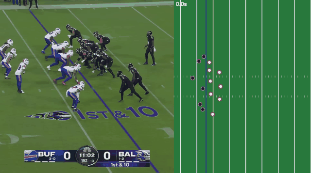
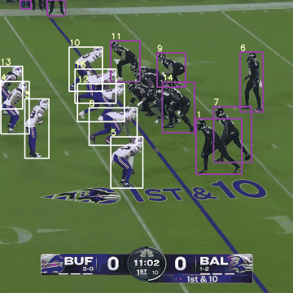
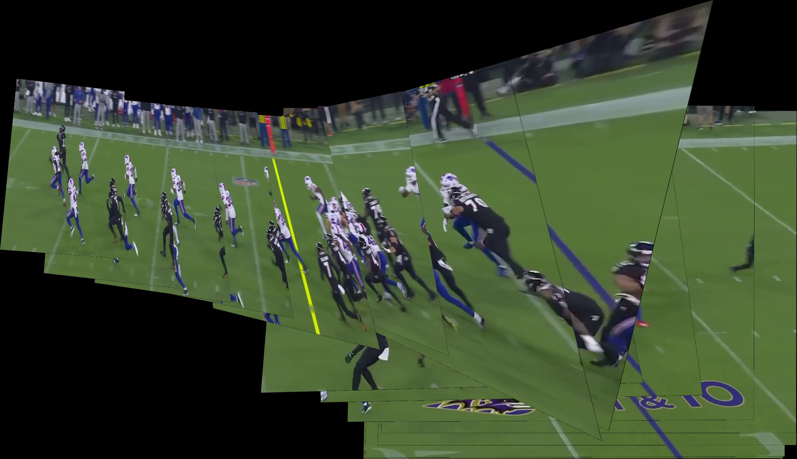

# 🏈 NFL 3D Replay

**NFL 중계 영상에서 선수를 추적하고, 움직이는 카메라를 보정해 실제 경기장 좌표(야드)로 바꾼 뒤 Unity에서 위에서 본 시점과 선수 시점으로 다시 재생하는 프로젝트**

> **English summary** — From a broadcast clip (Derrick Henry's TD run, BUF @ BAL), players are detected and tracked (YOLOv8m + ByteTrack). Because the broadcast camera pans and zooms, frame-to-frame homographies are estimated from background features and chained to the first frame, which is then calibrated to field coordinates (yards) using yard lines and hash marks. The first 6.7 s of the play (snap → run to the sideline) are mapped onto the field with < 0.5 yd error on held-out hash marks, smoothed, and replayed in Unity (top view + player POV). After 6.7 s the camera zooms in so tightly that field markings disappear and the accumulated error breaks the mapping; that part is shown as 2D tracking only.

| 위에서 본 재생 (0 ~ 6.7초, 경기장 좌표) | 전체 플레이 추적 (터치다운까지) |
|---|---|
|  |  |

흰색 = 버팔로(BUF), 검정·보라 = 볼티모어(BAL)

## 왜 만들었나

중계 화면은 카메라가 공을 따라가기 때문에, 한 플레이에서 22명이 각자 어떻게 움직였는지 한눈에 보기 어렵습니다. 경기 영상만으로 선수 위치를 경기장 좌표로 뽑아내면, NFL의 Next Gen Stats처럼 센서 없이도 위에서 내려다본 재생이나 특정 선수 시점의 재생을 만들 수 있다고 생각했습니다.

## 동작 방식

```
영상 ─▶ ① 선수 탐지·추적 ─▶ ② 카메라 움직임 추정 ─▶ ③ 첫 화면 → 경기장 좌표
                                                          │
Unity 재생 ◀─ ⑤ 궤적 평활화 ◀─ ④ 경기장 좌표 변환·필터·팀 분류 ◀┘
```

| 단계 | 스크립트 | 내용 |
|---|---|---|
| ① | `01_track_players.py` | YOLOv8m(COCO 사전학습)으로 사람 탐지, ByteTrack으로 프레임 간 ID 유지 |
| ② | `02_camera_motion.py` | 선수·스코어보드를 가린 배경 특징점을 광류로 추적해 프레임 간 호모그래피 추정, 누적해서 모든 프레임을 첫 화면 기준으로 정렬 |
| ③ | `03_field_calibration.py` | 첫 화면의 야드 라인 × 사이드라인·해시마크 교차점 6개로 경기장(야드) 좌표 변환 계산 |
| ④ | `04_to_field.py` | 선수 발 위치를 경기장 좌표로 변환, 경기장 밖(벤치·관계자) 제거, 유니폼 색으로 팀 분류 |
| ⑤ | `05_smooth_tracks.py` | 짧은 공백 보간, Savitzky-Golay 필터로 떨림 제거 |
| ⑥ | `06_make_gifs.py` | 결과 이미지 생성 |

**왜 카메라 보정이 필요한가**: 중계 카메라는 22번 러닝백을 따라 회전하고 확대합니다. 화면 좌표를 그대로 쓰면 선수가 가만히 있어도 카메라가 움직이면 위치가 바뀝니다. 중계 카메라는 한자리에서 회전·줌만 하므로 연속한 두 프레임의 관계를 호모그래피 하나로 표현할 수 있고, 이를 이어 붙이면 모든 프레임을 같은 기준으로 맞출 수 있습니다.


*검증: 0~6.7초 프레임을 첫 화면 기준으로 이어 붙인 파노라마. 사이드라인과 야드 라인이 프레임을 넘어 이어집니다.*

## 검증과 결과

- **경기장 좌표 정확도**: 기준점으로 쓰지 않은 해시마크 눈금 5개를 변환한 결과, 규격 위치(사이드라인에서 23.58 / 29.75야드)와의 차이가 **0.5야드 이내**, 1야드 눈금 위치와도 0.2야드 이내로 맞았습니다.
- **추적**: 큰 모델(YOLOv8m)과 높은 입력 해상도(960)로 바꾸자 2초 이상 유지되는 ID가 20 → 23개로 늘었고, 22번 러닝백이 6.7초 이후 235프레임 중 232프레임에서 같은 ID로 유지됩니다.
- **필터**: 경기장 밖 사람과 사이드라인 스태프를 제거해 0~6.7초 구간의 ID 57개 → 25개, 프레임당 약 11명.
- **평활화**: 프레임 간 떨림(평균 가속도) 0.178 → 0.024 야드/프레임², 원래 위치와의 차이는 평균 0.18야드.

## 한계

- **6.7초 이후는 경기장 좌표로 변환하지 않았습니다.** 카메라가 22번을 바짝 확대하면 화면에 경기장 표시가 거의 남지 않고, 특징점이 사이드라인의 움직이는 사람들에게 잡혀 오차가 누적됩니다. 7.7초 무렵에는 사이드라인에 서 있는 사람들이 경기장 밖 12~16야드로 계산될 만큼 오차가 커지는 것을 확인했습니다. 경기장 바닥의 특징점만 쓰는 방식도 시도했지만 확대 구간에서는 오히려 나빠졌습니다.
- **뭉친 선수는 하나로 잡힙니다.** 라인맨들이 붙어 있는 구간은 사전학습 모델이 박스 하나로 탐지해, 첫 화면 22명 중 16명 정도만 잡힙니다.
- **ID가 바뀌는 경우가 있습니다.** 선수가 겹칠 때 ID가 다른 선수에게 넘어갑니다(예: 4.8초에 버팔로 수비수의 ID가 22번에게 넘어감). 그래서 팀은 ID가 아니라 프레임마다 판단합니다. 같은 이유로 22번 시점 카메라는 4.8초 이후만 지원합니다.
- **기준점은 직접 찾았습니다.** 첫 화면의 경기장 표시 위치를 사람이 지정했습니다.

## 다음 단계

- **All-22 영상**: 경기장 전체를 고정에 가까운 화면으로 찍은 코치 필름을 쓰면 카메라 보정 오차가 크게 줄어 터치다운까지 재현할 수 있을 것으로 봅니다.
- **실제 추적 데이터와 비교**: NFL Big Data Bowl의 Next Gen Stats 추적 데이터에 같은 플레이가 있다면, 영상에서 뽑은 좌표의 오차를 직접 측정할 수 있습니다.
- **프레임별 경기장 인식**: 누적 대신 프레임마다 경기장 라인을 인식해 위치를 계산하는 방식(스포츠 중계 카메라 캘리브레이션)
- **미식축구 데이터로 추가 학습**: 뭉친 선수 분리와 ID 유지 개선

## 실행 방법

### Python
```bash
cd python
pip install -r requirements.txt
# 원본 영상을 python/data/nfl_sample.mp4 로 저장 (아래 '데이터 출처')
python scripts/01_track_players.py        # ~10분 (CPU)
python scripts/02_camera_motion.py --panorama
python scripts/03_field_calibration.py
python scripts/04_to_field.py
python scripts/05_smooth_tracks.py
python scripts/06_make_gifs.py
```
결과: `python/data/field_tracks.csv` (frame, id, team, X, Y). X는 경기장 길이 방향, Y는 먼 쪽 사이드라인에서의 거리(야드)입니다.

### Unity (6000.0, URP)
1. `Assets/Scenes/MainScene.unity`를 엽니다.
2. ▶ 재생. `FieldReplay`가 `python/data/field_tracks.csv`를 읽어 경기장과 선수를 그립니다.

| 키 | 동작 |
|---|---|
| Space | 재생 / 정지 |
| ← / → | 한 프레임씩 이동 |
| ↑ / ↓ | 재생 속도 (기본 0.5배속) |
| R | 처음으로 |
| C | 위에서 보기 ↔ 선수 시점 |
| Tab | 시점 선수 변경 (기본: 22번 러닝백) |

## 프로젝트 구조

```
├── Assets/
│   ├── Scenes/MainScene.unity
│   └── Scripts/
│       ├── FieldReplay.cs         # 재생, 경기장 그리기, 카메라 전환
│       ├── FieldTracksLoader.cs   # CSV 로더
│       └── CameraRig.cs           # 선수 시점 카메라 (달리는 방향을 바라봄)
├── python/
│   ├── scripts/                   # 01 ~ 06 파이프라인
│   ├── experiments/               # 초기 시도 (DeepSORT + 화면 안정화)
│   └── data/                      # 추적 결과, 호모그래피, 경기장 좌표
└── media/                          # README 이미지
```

## 개발 과정

1. 프레임마다 YOLOv8n으로 탐지하고 화면 픽셀 좌표를 그대로 Unity에 옮김 → 카메라가 움직이면 위치가 틀어짐
2. DeepSORT 추적 + 화면 안정화 + 경기장 영역(ROI) 필터 시도 (`python/experiments/`)
3. ByteTrack 추적 + 카메라 움직임 누적 보정 + 경기장 규격 기반 좌표 변환으로 재구성, 보정이 믿을 만한 구간을 검증으로 확인

## 데이터 출처

- 영상: [King Henry just showing off on SNF](https://www.youtube.com/watch?v=4T1pKwU7PuA) — NFL 공식 YouTube. 저작권 때문에 영상 파일은 레포에 포함하지 않습니다.
- 모델: [Ultralytics YOLOv8](https://github.com/ultralytics/ultralytics) (COCO 사전학습 가중치)

## License

MIT (코드에 한함. 영상과 영상에서 나온 이미지의 권리는 NFL에 있습니다.)
